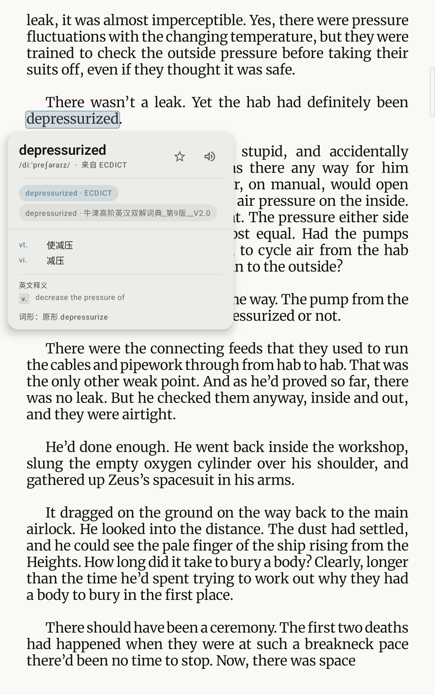
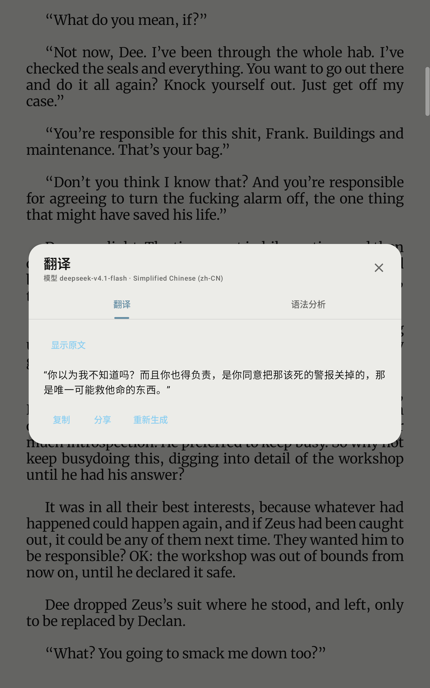
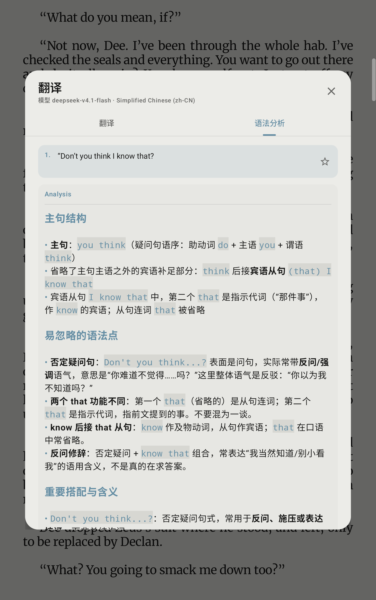

> [!Caution]
>
> Starting in September 2026, Android will require all apps to be registered by verified developers
> in order to be installed on certified Android devices.
> It means that **Book's Story will no longer be available** for installation on any certified
> Android device.
>
> https://keepandroidopen.org/

---

<!------------ Fork ------------>

## 🍞 麦麦阅读器 (MaiMai Reader)

**This repository is a fork of [Book's Story](https://github.com/Acclorite/book-story) by
[Acclorite](https://github.com/Acclorite), released as 麦麦阅读器 v2.0.**

- **Upstream source:** <https://github.com/Acclorite/book-story>
  (upstream tracked locally as the `upstream` git remote)
- **License:** [GPL-3.0-only](LICENSE) — the same license as upstream. Copyright © 2024-2026
  Acclorite; modifications in this fork © their respective authors.
- **Source code of this fork:** <https://github.com/kijhtybbu/reader> — the complete corresponding
  source, including every modification, as required by GPL-3.0 §5.

In-app: **About → Upstream source / License / Source code** carries the same information, and
**About → Open source licenses** lists all bundled third-party libraries. The formal distribution
notice required by GPL-3.0 §5 (upstream, baseline, list of modifications, corresponding source,
third-party components) is in [`NOTICE.md`](NOTICE.md).

---

<!------------ 中文说明 ------------>

## 📖 软件介绍

**麦麦阅读器 2.0** 是一款离线优先的中文电子书阅读器，在 Book's Story 的基础上补齐了中文阅读最常用的几件事：**离线查词、AI 段落翻译与语法分析、按书排版、单词与句子收藏**。

无账号、无广告、无统计上报。支持 EPUB / PDF / TXT / FB2 / HTML / Markdown，书库、进度、收藏与设置全部留在本机；内置 ECDICT（77 万词条）首次启动离线安装，不联网也能查词。

### 重点功能（相对上游新增）

| 能力 | 说明 |
| --- | --- |
| **离线取词** | 点按或长按单词，弹出锚定在该词上的卡片；内置 ECDICT，可再导入 MDX / StarDict 词典，支持 `.mdd` 里的图片、样式表与真人发音，多词典以 chip 切换 |
| **AI 翻译与语法** | 双击段落流式翻译，并给出逐句语法分析；兼容 OpenAI 接口，也可指向 Ollama / LM Studio / llama.cpp 等本地模型（免 Key）；结果按提示词版本、模型、目标语言缓存，重开秒回 |
| **按书排版** | 字号、行高、段距、字距、缩进、对齐、边距可只对当前书覆盖，面板内带实时预览，一键恢复全局默认 |
| **按书翻译器** | 取词手势（单击 / 长按 / 关闭）与双击翻译逐书生效，默认关闭，避免干扰只想读中文书的场景 |
| **收藏夹** | 单词与句子一键收藏，主导航统一管理；单词带音标、释义与发音，句子可回看译文与语法分析 |
| **来源与授权** | 「关于」页明确标出上游项目、GPL-3.0-only 授权协议与本分支源码地址 |

### 截图（真机，中文界面）

<table>
  <tr>
    <td width="50%"></td>
    <td width="50%"></td>
  </tr>
  <tr>
    <td align="center"><b>离线取词</b>：ECDICT 与导入的牛津高阶并列，可切词典、可发音</td>
    <td align="center"><b>AI 翻译</b>：双击段落，流式返回译文，可复制 / 分享 / 重新生成</td>
  </tr>
  <tr>
    <td width="50%"></td>
    <td width="50%"></td>
  </tr>
  <tr>
    <td align="center"><b>语法分析</b>：逐句展开主句结构、易忽视的语法点与搭配，词可点查、句子可收藏</td>
    <td align="center"><b>收藏夹</b>：单词 / 句子两个标签，全局共享</td>
  </tr>
  <tr>
    <td width="50%"></td>
    <td width="50%"></td>
  </tr>
  <tr>
    <td align="center"><b>按书排版</b>：「本书」与全局不同时标出差异项，可一键恢复</td>
    <td align="center"><b>按书翻译器</b>：取词手势与双击翻译逐书开关</td>
  </tr>
  <tr>
    <td width="50%"></td>
    <td width="50%"></td>
  </tr>
  <tr>
    <td align="center"><b>关于</b>：版本、上游来源、授权协议、源码入口</td>
    <td></td>
  </tr>
</table>

> 截图同时放在 `fastlane/metadata/android/zh-CN/images/phoneScreenshots/`，供 F-Droid 等商店直接使用。
> 左上角时间与电量是抓图时的系统状态栏，不是应用界面；翻译与语法分析用的是用户自备的
> OpenAI 兼容接口（截图中为 `deepseek-v4.1-flash`）。

---

<!------------ Header ------------>

  
  <h1>麦麦阅读器</h1>
  <h3>Material You eBook Reader for Android — a fork of Book's Story</h3>
  
Dive into the world of adventure as you discover your favorite book's story!

---

<!------------ Badges ------------>

<a href=""></a>
<a href=""></a>
<a href=""></a>
<a href=""></a>
<a href="">[![IzzyOnDroid](https://img.shields.io/endpoint?url=https://apt.izzysoft.de/fdroid/api/v1/shield/ua.acclorite.book_story&labelColor=27303D&color=3f9b84&label=IzzyOnDroid&logo=)](https://apt.izzysoft.de/fdroid/index/apk/ua.acclorite.book_story)</a>
<a href=""></a>
<a href=""></a>
<a href=""></a>

<!------------ Overview ------------>

<h1>Overview</h1>

Enjoy a sleek, customizable **reading app** with modern design, built with Jetpack Compose. It’s
open-source, offering you a personalized, ad-free journey through your favorite books!

---

<!------------ Screenshots ------------>

## 🖌️ Screenshots

  
  
  
  

  
  
  

---

<!------------ Features ------------>

## 🔮 Features

- Storage Access Framework
- 7 supported file formats(.pdf, .txt, .epub, .fb2, .html, .htm, .md)
- Material You design with unique themes and color presets
- Organized Library with custom categories and chapters in the Reader
- Highly customizable

### Phase 2 additions (this fork)

- **Offline dictionary lookup** — the full ECDICT database (770,611 entries, MIT) is bundled and
  installed on first launch; tap or long-press a word for a card anchored to it. No network needed.
- **MDX / StarDict import** — import your own `.mdx` file or a StarDict folder, enable/disable
  dictionaries and pick a preferred one. An MDX dictionary can be imported together with its `.mdd` resource packs (images, stylesheets, fonts, recorded pronunciation) through the folder entry.
- **AI paragraph translation and grammar** — double-tap a paragraph for a centered dialog with
  streaming translation and structured grammar analysis. Results are persisted in Room
  (keyed by prompt version, model, target language and endpoint host), so opening the same
  paragraph again is instant and makes no request.
- **Keyless local endpoints** — OpenAI-compatible Base URL + model, with the API key encrypted by
  Tink. Local services reachable at `localhost` / `127.0.0.1` / `10.0.2.2` (Ollama, LM Studio,
  llama.cpp server) may be used without a key.
- **Cache management** — the AI settings screen shows the cached result count and payload size
  and can clear the translation cache after a confirmation.
- **Word and sentence favorites** — tap the star on a dictionary card, or at the end of any sentence
  in the grammar tab, to save it to the global Favorites tab in the main navigation. Words show word,
  phonetic, definition and a pronunciation button; sentences open a dialog with the translation and
  grammar analysis.

The full design, decisions and known limits are in
[`docs/phase-2-design.md`](docs/phase-2-design.md).

Third-party data and source credits (also listed in **About → Licenses**):

- [ECDICT](https://github.com/skywind3000/ECDICT) — MIT. Bundled data: `app/src/main/assets/dictionaries/ecdict/`
  (`ECDICT-LICENSE.txt`, `NOTICE.txt`).
- [juicedict](https://github.com/qiuminal/juicedict) engine — GPL-3.0, vendored as `:dict-engine`.
  See [`third_party/juicedict-engine/LICENSE`](third_party/juicedict-engine/LICENSE) and
  [`PROVENANCE.md`](third_party/juicedict-engine/PROVENANCE.md).
- [openai-kotlin](https://github.com/aallam/openai-kotlin) — MIT.
- [Ktor](https://ktor.io) — Apache-2.0.
- [Tink](https://github.com/tink-crypto/tink-java) — Apache-2.0.
- [Apache Commons Compress](https://commons.apache.org/proper/commons-compress/) — Apache-2.0;
  [XZ for Java](https://tukaani.org/xz/java.html) — Public Domain.

---

<!------------ Download guide ------------>

## 🚚 Downloads

> [!Important]
>
> The app supports only Android versions from **Android 8.0** and above.

---

### 📲 How to install

- _**Installing from GitHub, GitLab, Codeberg**_: Click the "Get it on ..." badge above, select
  desired release, scroll down, and download
  **book-story.apk**. Once downloaded, locate the APK file and install it.
- _**Installing from F-Droid**_: Click the "Get it on F-Droid" badge above, scroll down, and click "
  Download APK" under your desired release version to download the APK file. Once downloaded, locate
  the file and install it.
- _**Installing from IzzyOnDroid**_: Click the "Get it on IzzyOnDroid" badge above, scroll down, and
  click "Download" to get the latest APK from IzzyOnDroid. Once downloaded, locate the file and
  install it.

---

<!------------ Translation ------------>

## 📜 Translation

> [!Important]
>
> You can help translating the app
> on [Hosted Weblate](https://hosted.weblate.org/engage/book-story/).
>
> I am thankful to everyone who helps make this app more accessible to others by translating it!

 

---

<!------------ Contribution ------------>

## 🤝 How to contribute

- **I do not accept code contributions.** This project is maintained
  solely by me, and I intend to keep it that way. Pull/merge requests will likely be closed, as they
  don’t align with the project's vision.
- **Submit your suggestions on Issues.** Feel free to share your thoughts!
- **Join the Matrix server** to share your ideas, report bugs, or just chat with me
  on [this server](https://matrix.to/#/#book-story:matrix.org)!
- **Share your ideas and suggestions.** If you’re missing a feature or have an interesting idea,
  feel free to create a new *Issue*.
- **Report bugs.** Encountered a crash or something went wrong? Create a new *Issue* with as much
  detail as possible to help resolve it.
- **Translate the app.** You can help make the app accessible in multiple languages. To contribute,
  visit [Hosted Weblate](https://hosted.weblate.org/engage/book-story/).
- **Enjoy the app.** The best contribution is simply using and enjoying the app I spent so much time
  on!

---

<!------------ Credits and License ------------>

## 🤗 Credits

> [!Note]
>
> Also listed in About > Credits.

- [Tachiyomi (Mihon)](https://github.com/mihonapp/mihon) (GitHub)
- [Kitsune](https://github.com/Drumber/Kitsune) (GitHub)
- [Voyager](https://voyager.adriel.cafe/) (Voyager Website)
- [Material Design Icons](https://fonts.google.com/icons) (Google Fonts)
- [Material Design Fonts](https://fonts.google.com) (Google Fonts)
- [Weblate Translators](https://hosted.weblate.org/projects/book-story) (Hosted Weblate)
- [GitHub Badge](https://github.com/Kunzisoft/Github-badge) (GitHub)
- [Codeberg Badge](https://codeberg.org/Codeberg/GetItOnCodeberg) (Codeberg)

---

## 🧾 License

  <pre>

麦麦阅读器 — Material You eBook reader for Android.
A fork of Book's Story. Licensed under GPL-3.0-only.

Book's Story — free and open-source Material You eBook reader.
Copyright © 2024-2026 Acclorite
Modifications in this fork are copyright © their respective authors.

Upstream source: https://github.com/Acclorite/book-story
Source of this fork: https://github.com/kijhtybbu/reader

This program is free software: you can redistribute it and/or modify
it under the terms of the GNU General Public License as published by
the Free Software Foundation, version 3 of the License.

This program is distributed in the hope that it will be useful,
but WITHOUT ANY WARRANTY; without even the implied warranty of
MERCHANTABILITY or FITNESS FOR A PARTICULAR PURPOSE. See the
GNU General Public License for more details.

You should have received a copy of the GNU General Public License
along with this program. If not, see <https://www.gnu.org/licenses/>.
  </pre>

