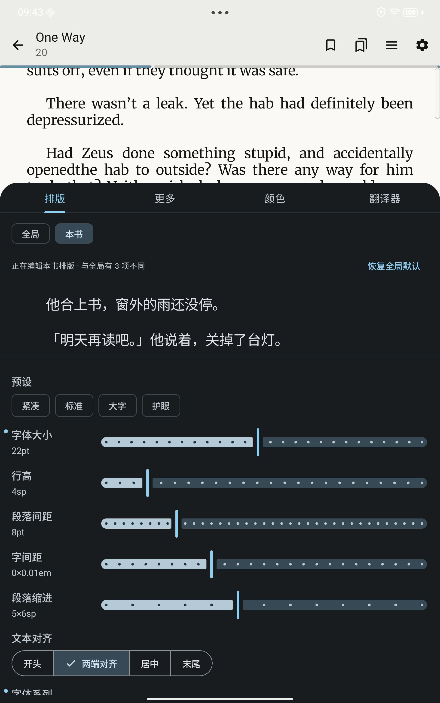
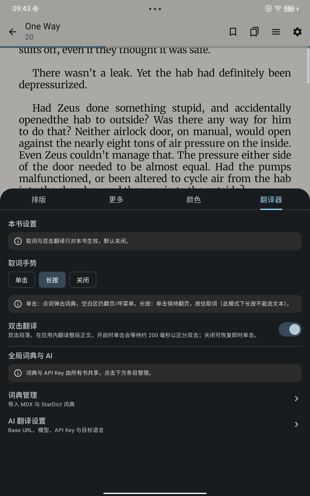
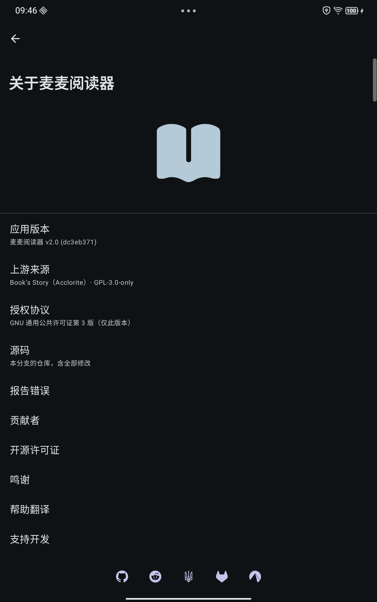

# 🍞 麦麦阅读器 (MaiMai Reader)

**麦麦阅读器（MaiMai Reader）v2.0** 是一款离线优先、面向中英阅读与语言学习的 Android 电子书阅读器，基于 Jetpack Compose 与 Material You 构建。

---

## ⚖️ 来源与授权声明 (Fork & License Notice)

本仓库派生自 [Acclorite](https://github.com/Acclorite) 开发的开源阅读器 **[Book's Story](https://github.com/Acclorite/book-story)**，按相同授权协议发布：

- **上游项目（Upstream）：** <https://github.com/Acclorite/book-story>（原作者版权 © 2024–2026 Acclorite）
- **授权协议（License）：** [GNU GPL-3.0-only](LICENSE) —— 本分支所有修改同样遵循 GPL-3.0-only 开源分发
- **本分支完整源码（Corresponding Source）：** <https://github.com/kijhtybbu/reader>
- **合规与差异文档：**
  - [`NOTICE.md`](NOTICE.md) —— GPL-3.0 §5 要求的正式分发声明（来源、基线、修改摘要与第三方组件许可）
  - [`UPSTREAM_DIFF.md`](UPSTREAM_DIFF.md) —— 相对上游基线的完整架构、功能与缺陷修复对比
  - 应用内 **「关于 → 上游来源 / 授权协议 / 源码 / 开源许可证」** 同步展示上述信息

---

## ✨ 核心特性

**无账号、无广告、无遥测上报。** 书库、阅读进度、词典、翻译缓存与收藏全部保存在本机。支持 **EPUB、PDF、TXT、FB2、HTML、HTM、Markdown** 七种常见格式，可与原版 Book's Story 共存安装（包名 `dev.jia.reader`）。

### 1. 离线查词与富媒体词典
- **内置 77 万词条 ECDICT**：随包附带 MIT 授权的 ECDICT 英汉词库，首次启动在后台自动解压建立索引，完全离线可用；取词卡片直观展示音标、中文释义、英英释义及柯林斯星级 / 牛津 3000 / 四六级 / 考研 / 托福 / 雅思 / GRE / BNC 词频标签。
- **MDX / StarDict 自定义词典导入**：支持导入单文件 `.mdx`、带 `.mdd` 分卷资源包的 **MDX 文件夹**（样式表、插图、自定义字体、真人发音）以及 **StarDict 文件夹**（`.ifo` + `.idx(.gz)` + `.dict(.dz)` + `.syn`）；支持启用/禁用与指定优先词典，多词典命中时通过顶部候选芯片快速切换（向上滚动正文自动收起芯片释放阅读空间）。
- **混合渲染与真人发音**：纯文本词条采用原生 Compose 结构化卡片；含图片、表格、CSS 或音频的富媒体词条自动切换至封闭沙箱 WebView（禁脚本、禁外网、自适应暗色/羊皮纸配色与系统字号缩放）。发音优先播放 `.mdd` 内置真人录音（支持 **自动 / 美音 / 英音** 偏好），无录音或格式不支持时平滑回退至系统 TTS。

### 2. AI 段落翻译与逐句语法分析
- **双击段落即译**：双击任意正文段落（或选中文本点击「翻译」）弹出居中对话框，流式输出段落译文，支持原文折叠、复制、分享与重新生成。
- **逐句 Markdown 语法精讲**：自动按句切分段落，点击任意句子即可流式生成主句结构、从句拆解、易忽略语法点与固定搭配的 Markdown 讲解。
- **广泛兼容的接口与本地模型免 Key 支持**：支持任意 OpenAI 兼容接口（内置 OpenAI、DeepSeek、Gemini、OpenRouter、OpenCode Go、Ollama 预设）；API Key 经由 Google Tink（`AES256-GCM` + Android Keystore）本地加密存储。指向 `localhost` / `127.0.0.1` / `10.0.2.2` 的本地服务（如 Ollama、LM Studio、llama.cpp）可免 Key 直接调用。
- **思考强度控制与本地持久化缓存**：支持切换推理模型的思考强度（关闭 / 低 / 中 / 高 / 默认）并实时展示思考字数或等待时长；完整译文与语法分析按「提示词版本 + 模型 + 目标语言 + 接口域名 + 规范化正文 SHA-256」持久化至本地 Room 缓存（20,000 条 / 200 MB LRU），重复打开零延迟、零 Token 消耗。

### 3. 单词与句子收藏夹
- **主导航一级「收藏」页**：与书库、历史、浏览并列，分为「单词」与「句子」两个标签，全局跨书共享。
- **一键收藏与复盘**：取词卡片右上角点击五角星即可收藏单词（保存词头、音标与核心释义，列表中支持直接发音或点击重开完整词典卡片）；语法分析标签中每句末尾均设独立五角星，收藏后随时回看原句、译文与语法解析。

### 4. 按书独立排版、按书翻译器与中文字体导入
- **按书排版（全局 / 本书）**：每本书可独立覆盖 12 项排版参数（字体、字重、粗体字重、斜体、字号、行距、段距、字距、首行缩进、对齐方式、左右与上下边距），与全局不同的参数自动标出差异圆点，支持在全局与本书间随时切换或一键恢复全局默认。
- **高频排版面板与实时预览**：重构阅读器底部设置面板为 **「排版 / 更多 / 颜色 / 翻译器」** 四栏，首栏汇聚 7 项高频控件、**紧凑 / 标准 / 大字 / 护眼** 4 组一键预设及顶部固定实时样例预览。
- **用户字体导入与中文字形回退**：支持导入 `.ttf` / `.otf` 字体（含静态与可变字体），自动解析 `cmap` 表检测汉字及全角标点覆盖率并提供三行实测预览；通过 `Typeface.CustomFallbackBuilder` 构建系统回退链，即使导入纯西文字体也能平滑回退系统中文而不出豆腐块。
- **按书开启翻译器**：取词手势（**关闭 / 单击取词 / 长按取词**）与 **双击段落翻译** 均按书独立保存且默认关闭，读外文书时开启、读中文书时零干扰。

### 5. 阅读交互与本地化体验打磨
- **TXT 编码自动探测与手动切换**：按 `BOM → 严格 UTF-8 → 严格 GB18030 → 严格 Big5` 探测编码并支持手动切换，彻底解决 GBK 中文网文乱码问题。
- **分页与连续滚动双模式**：分页模式支持平移与淡入淡出翻页动画、三种点击分区（Kindle 式 / 上中下 / 仅中间）、左右 10% 边缘快速翻页带以及跨章顶部提示。
- **段落级书签**：按 `(nodeId, nodeIntraOffset)` 定位并按段落去重，修改字号重新分页后依然精准跳转。
- **自适应阅读配色（ReaderPalette）**：上下工具栏、弹窗、取词卡片与系统状态栏图标明暗均从当前阅读背景色派生，并做 WCAG 对比度保底，夜间与羊皮纸模式下不再闪白或割裂。

---

## 📱 真机截图

<table>
  <tr>
    <td width="50%"></td>
    <td width="50%"></td>
  </tr>
  <tr>
    <td align="center"><b>离线取词</b>：内置 ECDICT 与导入的牛津高阶并列，支持多词典切换与发音</td>
    <td align="center"><b>AI 段落翻译</b>：双击段落流式返回译文，可复制、分享或重新生成</td>
  </tr>
  <tr>
    <td width="50%"></td>
    <td width="50%"></td>
  </tr>
  <tr>
    <td align="center"><b>逐句语法分析</b>：展开主句结构、易忽略语法点与固定搭配，单句可独立收藏</td>
    <td align="center"><b>全局收藏夹</b>：主导航集中管理收藏的单词与句子，随时发音或回看解析</td>
  </tr>
  <tr>
    <td width="50%"></td>
    <td width="50%"></td>
  </tr>
  <tr>
    <td align="center"><b>按书排版</b>：「本书」模式下带实时预览与差异圆点标记，可一键恢复全局默认</td>
    <td align="center"><b>按书翻译器</b>：取词手势与双击翻译按书独立开关，默认关闭不打扰纯阅读</td>
  </tr>
  <tr>
    <td width="50%"></td>
    <td width="50%"></td>
  </tr>
  <tr>
    <td align="center"><b>关于与合规声明</b>：清晰展示版本号、构建哈希、上游来源、GPL-3.0 协议与源码入口</td>
    <td></td>
  </tr>
</table>

---

## 🛠️ 构建与验证

### 环境要求
- **Android 系统版本：** Android 10 及以上（`minSdk = 29`，`targetSdk = 36`）
- **构建工具：** JDK 17、Android SDK 36

### 构建与测试命令

```bash
export JAVA_HOME=/opt/homebrew/opt/openjdk@17
export ANDROID_HOME=$HOME/Library/Android/sdk

# 词典引擎单元测试 + 应用单元测试 + Debug 构建 + Release-debug (R8) 构建
./gradlew :dict-engine:test :app:testDebugUnitTest :app:assembleDebug :app:assembleRelease-debug
```

- `debug`（`dev.jia.reader.debug`）：开发调试包
- `release-debug`（`dev.jia.reader.release.debug`）：开启 R8 混淆压缩并使用 debug 签名的验收包，用于验证 ProGuard 规则与真实运行表现

更多设计细节参见：
- [`docs/phase-2-design.md`](docs/phase-2-design.md) —— 离线词典、AI 翻译、语法分析与缓存架构设计
- [`docs/dictionary-resources-design.md`](docs/dictionary-resources-design.md) —— MDD 资源包、安全改写、混合渲染与发音设计
- [`docs/per-book-typography-design.md`](docs/per-book-typography-design.md) —— 按书排版作用域与存储设计
- [`docs/per-book-translator-design.md`](docs/per-book-translator-design.md) —— 按书翻译器行为设计

---

## 📦 第三方数据与组件致谢

应用内 **「关于 → 开源许可证 / 致谢」** 列出了全部依赖项，核心新增组件如下：

| 组件 | 许可协议 | 用途 |
| --- | --- | --- |
| [Book's Story](https://github.com/Acclorite/book-story) | GPL-3.0-only | 上游基座阅读器（© 2024–2026 Acclorite） |
| [ECDICT](https://github.com/skywind3000/ECDICT) | MIT | 内置离线英汉词典数据（`app/src/main/assets/dictionaries/ecdict/`） |
| [juicedict](https://github.com/qiuminal/juicedict) | GPL-3.0 | StarDict / MDict 词典解析引擎（vendored 于 `third_party/juicedict-engine/`） |
| [openai-kotlin](https://github.com/aallam/openai-kotlin) | MIT | OpenAI 兼容接口流式客户端 |
| [Ktor](https://ktor.io) | Apache-2.0 | HTTP 网络引擎 |
| [Google Tink](https://github.com/tink-crypto/tink-java) | Apache-2.0 | API Key 本地 AES-GCM 加密存储 |
| [Apache Commons Compress](https://commons.apache.org/proper/commons-compress/) & [XZ for Java](https://tukaani.org/xz/java.html) | Apache-2.0 / Public Domain | 内置词典 7z (LZMA2) 解压 |

---

## 🧾 许可证 (License)

```text
麦麦阅读器 (MaiMai Reader) — Material You eBook reader for Android.
A fork of Book's Story. Licensed under GPL-3.0-only.

Book's Story — free and open-source Material You eBook reader.
Copyright © 2024-2026 Acclorite
Modifications in this fork are copyright © their respective authors.

Upstream source: https://github.com/Acclorite/book-story
Source of this fork: https://github.com/kijhtybbu/reader

This program is free software: you can redistribute it and/or modify
it under the terms of the GNU General Public License as published by
the Free Software Foundation, version 3 of the License.

This program is distributed in the hope that it will be useful,
but WITHOUT ANY WARRANTY; without even the implied warranty of
MERCHANTABILITY or FITNESS FOR A PARTICULAR PURPOSE. See the
GNU General Public License for more details.

You should have received a copy of the GNU General Public License
along with this program. If not, see <https://www.gnu.org/licenses/>.
```
